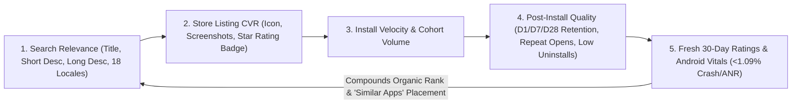
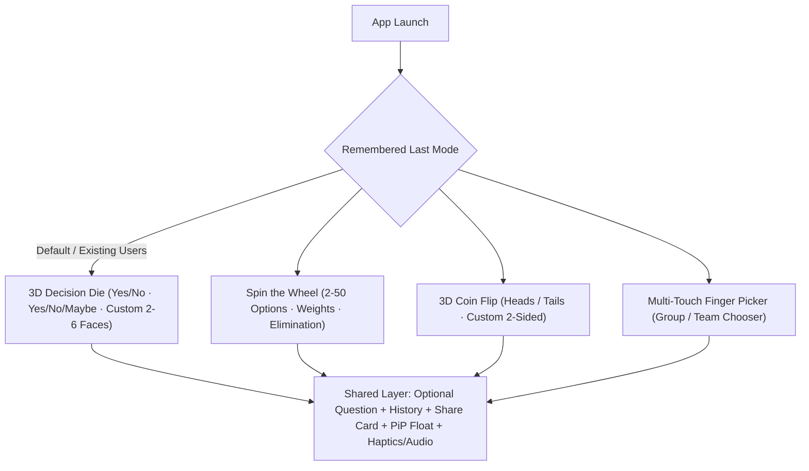

# Yes/No Randomizer — Competitive Analysis, Play Store Reality Check & Growth Plan

> **Snapshot date:** November 27, 2026  
> **App baseline:** `com.sblashkov.yesnorandomizer` (v3.6 / versionCode 27)  
> **Strategic parameters:** Balanced 10-competitor benchmark (5 direct binary/tactile peers + 5 breakout decision-maker leaders) · Open to feature expansion & rebranding while remembering the user's last-used mode · Ad-free core + one-time Pro IAP monetization · Play Families vs. 13+ tradeoff analysis · Combined product, Android surface, and Play Store growth strategy.

---

## 1. Current App Audit (Code, UX/UI & Store Listing)

### What You Already Do Exceptionally Well
Inspecting the repository reveals an unusually high level of engineering polish for an indie utility app:

- **Genuine 3D Tactile Craftsmanship:** Custom OpenGL ES 2.0 rounded cube ([AnswerDice.kt](../app/src/main/java/com/sblashkov/yesnorandomizer/ui/AnswerDice.kt)) rendered inside a dedicated GL thread ([DiceTextureView.kt](../app/src/main/java/com/sblashkov/yesnorandomizer/ui/DiceTextureView.kt)) **on-demand only** (zero continuous render loop while idle — avoiding the #1 battery-drain complaint in 3D dice apps).
- **Direct Physics Manipulation ("Fidget / Cheat" Mode):** Quaternion drag, flick momentum, mid-spin catch, and upright settling ([DiceMotion.kt](../app/src/main/java/com/sblashkov/yesnorandomizer/ui/DiceMotion.kt), [DiceGestures.kt](../app/src/main/java/com/sblashkov/yesnorandomizer/ui/DiceGestures.kt)), paired with subtle landing haptics (`CLOCK_TICK`). Almost zero competitors offer this level of physical polish.
- **Unique Multitasking Edge (Picture-in-Picture):** **Float answer** ([MainActivity.kt](../app/src/main/java/com/sblashkov/yesnorandomizer/MainActivity.kt#L108-L143)) pins the question and result over other apps with a live **New Answer** `RemoteAction` directly inside the PiP controls. None of the 10 top competitors advertise or deliver this cleanly.
- **Best-in-Class Localization & On-Device Translation:** 18 bundled locales with automatic system preference matching ([AppLanguage.kt](../app/src/main/java/com/sblashkov/yesnorandomizer/AppLanguage.kt)), live in-place locale/RTL/theme switching without recreating the GL surface, plus on-device ML Kit question translation ([QuestionViewModel.kt](../app/src/main/java/com/sblashkov/yesnorandomizer/translation/QuestionViewModel.kt)).
- **Modern Android Hygiene:** Material 3 Light/Dark palette ([Color.kt](../app/src/main/java/com/sblashkov/yesnorandomizer/ui/theme/Color.kt)), adaptive portrait/landscape/tablet layout ([DecisionLayout.kt](../app/src/main/java/com/sblashkov/yesnorandomizer/ui/DecisionLayout.kt)), `targetSdk 37`, strong test suite, and cohesive localized store visuals ([01-en-US-phone-1080x1920.png](../store-assets/2026-09/localized/locales/en-US/phone/01-en-US-phone-1080x1920.png), [play-store-icon-512.png](../store-assets/2026-10/app-icon-options/play-store-icon-512.png)).

### Current Product & Listing Blind Spots (Why Growth Stalls at ~30 Devices)
1. **Narrow Utility Ceiling ("Why not just Google it?"):** Both Google Search and voice assistants already answer *"yes or no"* and *"flip a coin"* in one tap. Without saved presets, multi-option modes, widgets, or history, users have little reason to install—or keep—a single-mode Yes/No app.
2. **Fixed 3-Second Roll Duration:** `rollTo()` hardcodes a 3,000 ms animation ([AnswerDiceState.kt](../app/src/main/java/com/sblashkov/yesnorandomizer/ui/AnswerDiceState.kt#L98)) with both **Decide!** and **Float answer** disabled while rolling. It looks great the first time, but feels slow on repeat decisions if there is no fast mode or tap-to-settle.
3. **Zero Persistence, Audio, or Sharing Loops:** Only transient `SavedStateHandle` task state is kept—no decision history, no saved setups, no sound effects, no shareable result card, no Home Screen widget, and no in-app review prompt.
4. **Under-Optimized Play Store Metadata:**
   - The title `Yes/No Randomizer` ([title.txt](../store-assets/2026-09/localized/locales/en-US/title.txt)) uses only **17 of 30 characters** and misses the highest-intent category terms (*Decision Maker*, *Yes or No*, *Wheel*, *Coin*, *Picker*).
   - The live description ([full-description.txt](../store-assets/2026-09/localized/locales/en-US/full-description.txt)) still omits v3.5's tactile swipe/cheat physics and v3.4's on-device translation, while unconditionally claiming *"no internet connection required"* (which conflicts with ML Kit's Wi-Fi model downloads).
5. **Active Release Blocker & Missing In-App Privacy Policy:** Per [data-safety-review.txt](data-safety-review.txt) and [next-session.md](next-session.md), v3.6 (27) was rejected over Data Safety (undeclared ML Kit telemetry + an unresolved Email Address finding), the app lacks a visible in-app Privacy Policy entry, and it currently declares ages **6–17** (triggering Google Play's strict Families Policy).

---

## 2. Ten Successful Competitors on Google Play

To benchmark both your **immediate peers** and the **category winners** capturing 1M–50M+ installs, the 10 selected apps are split evenly: 5 direct binary/oracle/tactile peers and 5 breakout decision-maker/randomizer leaders.

### Summary Matrix

| # | App & Developer | Tier | Est. Installs | Rating | Monetization | Signature Strength | Primary Review Gap / Weakness |
|---|---|---|---|---|---|---|---|
| 1 | **Yes or No - Decision Maker** *(DCZT / David Krejci)* | Direct Binary | 100K+ *(Android)* | ~3.7★ *(Play)* / ~4.4★ *(iOS)* | Ads + "Remove Ads" IAP | Instant Yes/No button + lightweight mini-toolkit (coin, wheel, RNG, finger picker) | **Broken "Remove Ads" IAP**, missing Restore Purchases button, unresponsive dev support |
| 2 | **Yes or No** *(Fapesoft)* | Direct Binary *(Social)* | ~630K+ | ~4.25★ *(3.9K)* | Ads + Remove Ads IAP | Captures huge "Yes or No" search traffic via live community polls & user questions | Requires internet, repetitive/childish prompts, intrusive ads — doesn't solve *personal* choices |
| 3 | **Coin Toss - Heads or Tails** *(PlayRoof)* | Direct Binary *(Coin)* | ~370K+ | ~4.70★ *(4.3K)* | Ads | Instant 1-tap launch, crisp coin animation, zero setup friction | Interstitial ads on a 2-second task, zero history/customization, "just Google it" objection |
| 4 | **Magic 8 Ball 3D** *(SupradenDev)* *(benchmark vs. Magic Ball by ALEXPLAY, 5M+, 3.4★)* | Direct Oracle *(3D Tactile)* | 500K+ *(ALEXPLAY: 5M+)* | ~4.5★ *(ALEXPLAY: 3.4★)* | Ads + Paid Pro app | Real PBR/IBL 3D rendering, 360° finger drag, shake-to-ask, 97 skins, custom answers | Free-tier ads, flaky shake sensors on budget phones; ALEXPLAY's 5M leader is stale & ad-heavy (3.4★) |
| 5 | **Dice Roller!** *(Harry Foster)* | Direct Tactile *(Dice)* | **21M+** | ~4.7★ | Heavy Ads + Remove Ads IAP | Roll 1–40 dice, **custom text/emoji/image faces**, 10 saved setups, lock dice, tap/shake + audio | **#1 complaint: intrusive mid-game ads** and distrust around paid ad-removal updates |
| 6 | **Decision Roulette** *(Treebit Technologies)* | Breakout Leader | **50M+** | ~4.4★ | Ads + Remove Ads IAP | 2–50 slice custom wheels, colors/images, premade templates, `.tdr` export/share, offline-first | **No native slice weights** (must duplicate entries), frequent ads, **no cloud sync** (data wiped on phone change) |
| 7 | **Spin The Wheel - Random Picker** *(noblepete)* | Breakout Leader | **10M–40M+** | **~4.8★** *(140K+)* | Ads + IAP | Unlimited wheels/labels, **weighted odds**, toggle items on/off without deleting, Wheel Store | Ads in free tier, no seamless cross-device cloud sync, **UI bloat** (chatrooms/store) annoys minimalists |
| 8 | **Random Number Generator** *(UXAPPS LTD)* | Breakout Leader | **~3.9M+** | ~4.46★ *(16K)* | Ads | Tiny (~5–9 MB) offline Swiss-Army knife (numbers, lists, dice, coins, wheel, cards, passwords) | Utilitarian flat UI with zero 3D delight, ad interruptions, no cloud backup or shareable results |
| 9 | **Tiny Decisions** *(NixWang / Appic)* | Breakout Indie Benchmark | Millions *(cross-platform)* | ~4.5★ *(varies by build)* | Freemium + Pro IAP/Sub | Cleanest UI in category; beloved for **ADHD / decision fatigue**; haptics, templates, Elimination & Teams | Paywalls basic convenience (weights, wheel limits), older Android UI lag/freezes, Android lags iOS polish |
| 10 | **Chwazi - Finger Chooser** *(Ivan Seidel Gomes)* | Tactile Cult Classic | **1M–4.7M+** | **~4.8★** | 100% Free, Zero Ads | Legendary zero-friction open-and-touch group chooser & team splitter; board-gamer word-of-mouth staple | Single-purpose (in-person screen touch only), missing Elimination mode & history, suffered Play API delisting |

---

### Deeper Competitor Inspection: What Wins vs. Where They Bleed Reviews

#### What Successful Competitors Do Well
1. **They solve repeat real-world routines, not one-off novelties:** The 10M–50M+ leaders (*Decision Roulette*, *Spin The Wheel*, *Dice Roller!*) win because users keep them installed for **recurring weekly scenarios**: *"What should we eat?"*, classroom student pickers, board game nights, giveaways, chores, and ADHD task paralysis.
2. **Fast entry + deep optional customization:** Top performers open directly into a runnable tool (zero login wall), offer **ready-made templates** so users don't face a blank screen, and let power users customize labels, colors, icons, weights, and presets.
3. **Sensory satisfaction ("Juice"):** Users consistently write 5-star reviews about **crisp animations, haptics, sound effects (ticks, clacks, chimes), and shake/flick physics** (*Tiny Decisions*, *Dice Roller!*, *Magic 8 Ball 3D*).
4. **Broad keyword alignment in Play Store titles:** Notice none of the top performers call themselves *"Randomizer"* alone—they lead with high-volume consumer phrases: **Decision Roulette**, **Spin The Wheel - Random Picker**, **Yes or No - Decision Maker**, **Dice Roller!**, **Flip a Coin**.

#### The 6 Biggest Gaps in Competitor Reviews (Your Competitive Opening)
1. **Ad Rage on Simple Utilities (#1 Complaint Across 8 of 10 Apps):** Users *despise* full-screen video ads interrupting a 5-second decision, and several competitors (*DCZT*, *Dice Roller!*) get 1-star review-bombed when paid "Remove Ads" purchases break or lack a Restore button.
2. **Feature Bloat vs. Instant Launch:** *Spin The Wheel* (chatrooms/wheel shop) and multi-tool clones bury the core action under clutter. Minimalists rave about *Chwazi* and *Tiny Decisions* precisely because opening the app means immediate action.
3. **Data Loss on Device Switch / Cache Clear:** Both *Decision Roulette* and *Spin The Wheel* receive recurring complaints from teachers and gamers who lose dozens of custom wheels because there is no clean cloud backup or export/import.
4. **"It's Rigged!" Randomness Distrust:** Streaks happen naturally in true 50/50 RNG, triggering 1-star "rigged!" reviews across coin, wheel, and dice apps. Almost no app addresses this with simple fairness transparency (roll history + distribution stats) or an optional **No-Repeat / Elimination** toggle.
5. **Missing Native Android Ecosystem Polish:** Almost none of the top competitors invest in modern Android-first ergonomics—**Home Screen Widgets**, **Quick Settings Tiles**, **Picture-in-Picture**, **adaptive tablets**, or **true battery-friendly on-demand 3D rendering**.
6. **Weak Android Maintenance & English-Only Shared Presets:** Several hits (*Tiny Decisions*, *Chwazi*, *Magic Ball*) treat Android as a second-class port or lag behind modern Material 3 / targetSdk / dark-mode standards, and shared/community presets are overwhelmingly stuck in a single language.

---

## 3. Play Store Algorithm Truth Check: Will Improving the App Make Google Promote It?

> **Short answer:** **Partially true—but mostly a misconception if you rely on passive updates alone.**  
> Your 2–3× surge after updating UX and store visuals is real proof that **conversion rate (CVR)** and **freshness** move the needle. However, shipping clean internal improvements on a 30-device app will **not** cause Google Play to spontaneously push you into thousands of installs.

### How Google Play Actually Decides Who Gets Promoted
1. **You Cannot Out-Rank a Keyword's Search Ceiling:** Play matches your listing against user search queries using NLP on your **App Title (30 chars — highest weight)**, **Short Description (80 chars)**, and **Long Description (4,000 chars)**. Right now, `Yes/No Randomizer` competes in a tiny search pool where Google's own web search widget already satisfies casual queries. Expanding both your **product modes** and **keyword footprint** unlocks 10×–50× larger search volume.
2. **Updates Help Only When They Improve Behavioral Metrics:** Google Play rewards regular updates as a maintenance/freshness signal, **not** as a free traffic faucet. What the ranking model actually promotes is:
   - **High Store Listing Conversion Rate (CVR):** Your visual overhaul boosted this (hence your 2–3× jump!).
   - **Retention & Engagement Depth (D1 / D7 / D28):** If users install, roll Yes/No twice, and uninstall on Day 1, Play interprets the app as low-value and suppresses discovery. Adding **widgets, saved presets, history, and multi-mode tools** directly turns a 1-day novelty into a kept utility.
   - **Rolling 30-Day Rating Velocity:** At 30 devices with no in-app review prompt, your listing lacks social proof (a visible `4.8★` badge). Moving from *no rating* to even *20–50 genuine 4.8★+ ratings* causes a step-function jump in CVR and search rank.
   - **Android Vitals Floor:** Staying well below the 1.09% user-perceived crash threshold and keeping `targetSdk` current prevents ranking penalties—you are already strong here!
3. **Cold-Start Reality at 30 Devices:** Google Play's recommendation surfaces (*"Similar apps"*, *"Suggested for you"*) need enough install and co-install data to know *who* likes your app. Going from **30 → 300–500 engaged devices** typically requires **better ASO keywords + small organic community seeding** to prime the pump—after which Google Play's organic flywheel starts doing real work for you.

---

## 4. Target Audience Analysis: Play Families (6–17) vs. General Audience (13+)

Per [data-safety-review.txt](data-safety-review.txt), the Play Console currently selects ages **6–8, 9–12, 13–15, and 16–17**, which places the app under **Google Play's Families Policy** (COPPA / GDPR-K rules). Because you plan to grow into **Freemium Pro IAP, cloud backup/sync, and broader features**, here is the tradeoff:

| Factor | Keep Ages 6–17 (Play Families Policy) | Shift to 13+ / 16+ General Audience |
|---|---|---|
| **ML Kit & SDK Scrutiny** | **High risk.** Every SDK telemetry payload (like ML Kit/Firebase installation IDs) faces strict child-privacy audits and higher rejection rates (already hurting v3.6). | **Low friction.** Standard Play Data Safety disclosure + visible in-app Privacy Policy fully covers on-device ML Kit and Google Play Billing. |
| **Freemium Pro IAP & Cloud Sync** | **Heavy UX overhead.** Requires child-safe purchase disclosures / neutral parental gates, restricts third-party sign-in / Drive sync flows for under-13 users. | **Standard Google Play Billing.** Clean one-time Pro unlock, Google Drive / Auto Backup sync, and shareable result cards work out of the box. |
| **Organic Discoverability** | Appears in Family filters, **but** decision-maker / wheel / party-picker searchers are overwhelmingly teens and adults (13+). No Teacher Approved badge is active anyway. | **Full mainstream Play search & recommendation eligibility** across Productivity, Tools, and Entertainment queries. |
| **"Unintentional Appeal" Risk** | Eliminated (already opted into Families). | **Manageable:** Keep visuals sleek, geometric, and Material 3 modern (your current clean blue/coral UI is already adult-friendly—avoid cartoon mascots or kid-centric copy like "kids game"). |

> [!TIP]
> **Recommendation:** Shift target audience to **13+ (or 16+ / 18+)** *before* launching Pro IAP and cloud sync—while keeping the app 100% wholesome and clean. Wait until the current v3.6 Data Safety inquiry is cleanly resolved, add the missing in-app Privacy Policy link, and align the privacy policy text + store visuals to a crisp, modern productivity/utility tone so it never triggers Google's "unintentional appeal to children" flag.

---

## 5. Ten Ways to Make the App More Robust & Competitive

These 10 recommendations combine **in-app product evolution**, **native Android OS surfaces**, **ASO/rebranding**, and **ethical freemium monetization**—directly targeting the review gaps of the 10 competitors above.

### Feature & Architecture Flow (Preserving Your Existing Dice Experience)

---

### 1. Multi-Mode Decision Hub with Remembered Default Mode
- **What to build:** Keep the instant **3D Yes/No Die** as the default launch screen and persist the user's last-selected mode in `SharedPreferences`/`DataStore` (so existing users never lose their zero-friction Yes/No workflow). Add a clean, low-profile mode switcher (compact segmented bar or bottom pill) for:
  1. **3D Die Mode:** Instant toggle between `Yes / No`, `Yes / No / Maybe`, and **Custom 2–6 Face Die** (assign custom text/emoji to each of the 6 cube faces—your OpenGL cube is *already* 6 faces!).
  2. **Spin the Wheel Mode:** Custom 2–50 option wheel with smooth Compose Canvas + inertial flick physics (reusing your quaternion/momentum design ethos!) and quick enable/disable toggles per slice without deleting.
  3. **3D Coin Flip Mode:** Crisp 2-sided metallic/minimal coin using your existing OpenGL pipeline.
  4. **Finger Picker Mode:** *Chwazi*-style instant multi-touch chooser for groups & board-game nights (plus the **Elimination Mode** that *Chwazi* fans constantly beg for!).
- **Competitor gap crushed:** Captures the 50M+ wheel/multi-tool demand without the bloat of *Spin The Wheel* or *UXAPPS*.
- **Tier:** Free (Yes/No Die, Coin, Finger Picker, Wheel up to 3 saved lists) · **Pro** (unlimited custom dice & wheel presets, Elimination & Team modes).
- **Solo-Dev ROI:** Effort **Medium–High** · Impact **Very High** *(expands addressable market by 10×+ and boosts D7/D28 retention)*.

### 2. Weighted Probabilities & Ready-Made Localized Starter Presets
- **What to build:**
  - Add a clean **Weight / Odds control**: in Yes/No mode, let users tilt the odds (e.g., 1–5 Yes faces vs. No faces on the 6-sided die, or a percentage bias); in Wheel mode, let users assign numeric weights (`1×`, `2×`, `5×`) per slice.
  - Ship **curated starter templates** localized in your 18 languages (*Dinner tonight*, *Movie genre*, *Weekend plan*, *Chore picker*, *ADHD: Pick my next task*, *Truth or Dare*), runnable in 1 tap.
- **Competitor gap crushed:** Solves *Decision Roulette*'s #1 feature complaint (no native weights) and removes "blank-canvas paralysis" for first-time users (a huge reason *Tiny Decisions* thrives in the ADHD community).
- **Tier:** Free (starter templates + basic Yes/No/Maybe) · **Pro** (custom slice/face weights & unlimited custom folders/templates).
- **Solo-Dev ROI:** Effort **Low–Medium** · Impact **High**.

### 3. Native Android OS Surfaces: Home Screen Widget & Quick Settings Tile
- **What to build:**
  - **Interactive Home Screen Widget (Jetpack Glance):** Tap right from the home screen to get an instant Yes/No answer (or trigger a pinned favorite wheel/preset) without even opening the app—plus a 1-tap shortcut to open full 3D mode.
  - **Android Quick Settings Tile (`TileService`):** Pull down the shade from anywhere to roll an instant Yes/No (or launch directly into your signature **Float answer PiP** window!).
  - **App Shortcuts (Long-Press Launcher Icon):** Jump straight to *Quick Yes/No*, *Coin Flip*, *Spin Wheel*, or *Finger Picker*.
- **Competitor gap crushed:** Decisively beats the *"why not just Google 'flip a coin'?"* objection on speed (1 tap vs. opening a browser) AND dramatically improves **D28 retention** (users rarely uninstall apps whose widget sits on their home screen).
- **Tier:** Free (basic Yes/No widget + Quick Settings Tile) · **Pro** (custom-preset widgets + themed widget styles).
- **Solo-Dev ROI:** Effort **Low–Medium** · Impact **Very High** *(unique Android-native edge none of the top 10 execute well)*.

### 4. Sensory Polish: Speed Control, Shake-to-Roll, Audio & 3D Die Skins
- **What to build:**
  - **Roll Speed Setting + Tap-to-Settle:** Currently `AnswerDiceState.kt` locks button rolls to 3,000 ms. Add **Quick (~1.0s) / Classic (~2.2s) / Instant** options, and let tapping a button-rolled die snap/catch it cleanly.
  - **Opt-In Sound Effects:** Soft, crisp synthesized/recorded wooden/ceramic clack on roll & land, wheel clicker ticks, and coin ping (muted by default if system ringer is silent; 1-tap mute toggle).
  - **Opt-In Shake-to-Roll:** Accelerometer shake trigger with a simple **Low / Medium / High sensitivity** setting (explicitly avoiding the broken-sensor complaints plaguing *Magic 8 Ball* and *Toss Heads or Tails*).
  - **Custom 3D Materials / Skins:** Leverage your custom OpenGL shader to offer gorgeous themes—*Material Dynamic Color (Android 12+)*, *Obsidian & Gold*, *Matte Ceramic*, *Warm Wood*, *Neon Glass*, *AMOLED Pure Black*.
- **Competitor gap crushed:** Matches the tactile delight of *Magic 8 Ball 3D* and *Tiny Decisions* while keeping your battery-friendly on-demand GL renderer.
- **Tier:** Free (Speed, Audio, Shake, Light/Dark + Dynamic Color) · **Pro** (Premium 3D die skins, custom face colors/emojis, wheel themes).
- **Solo-Dev ROI:** Effort **Medium** · Impact **High** *(drives 5-star review delight and gives Pro a tangible cosmetic anchor)*.

### 5. Decision History, Fairness Stats & 1-Tap Shareable Result Cards
- **What to build:**
  - **Local Decision Log:** Lightweight Room/DataStore history storing timestamp, optional question, mode, and outcome—with 1-tap *Re-roll this question*, *Pin to Favorites*, or *Clear history* (100% local & private).
  - **Subtle Fairness / Streak Counter:** An expandable mini stats pill (*e.g., "Last 20 rolls: 11 Yes / 9 No"*) plus an optional **"No Repeat / Best of 3"** mode. Directly defuses the universal *"it's rigged!"* 1-star reviews.
  - **Shareable Result Image Card:** One tap renders a clean, Instagram/WhatsApp-ready card showing the question + your stylized 3D die/wheel outcome (*"Pizza tonight? → YES!"*) with a subtle app footer.
- **Competitor gap crushed:** Creates a built-in **viral word-of-mouth loop** whenever friends/couples share a decision in group chat—something *Coin Toss*, *Chwazi*, and *UXAPPS* lack.
- **Tier:** Free (last 20 history items, fairness stats, standard share card) · **Pro** (unlimited searchable history, CSV/JSON export, watermark-free custom share cards).
- **Solo-Dev ROI:** Effort **Low–Medium** · Impact **High**.

### 6. Ethical "Zero-Ads Forever" One-Time Pro IAP + Backup/Sync & Shared Preset Auto-Translation
- **What to build:**
  - Make **"No Ads — Ever"** a core brand promise (Free tier stays genuinely usable and ad-free, funded by power users upgrading via a **one-time lifetime Pro purchase**, e.g., $2.99–$4.99—NO nagging subscriptions!).
  - Implement Google Play Billing cleanly with automatic `queryPurchasesAsync` on launch **plus an explicit "Restore Purchases" button** in Settings.
  - Solve competitors' #1 power-user fear (lost custom wheels/presets) with **1-tap JSON Export/Import**, Android **Auto Backup** rules (already declared in `AndroidManifest.xml`), and optional **Google Drive AppData Sync** (Pro).
  - **Shared Preset & Wheel Auto-Translation via ML Kit (Pro — "Global Presets & Sharing"):** Reuse your existing on-device ML Kit translation pipeline ([MlKitQuestionTranslator.kt](../app/src/main/java/com/sblashkov/yesnorandomizer/translation/MlKitQuestionTranslator.kt), [QuestionTranslationSession.kt](../app/src/main/java/com/sblashkov/yesnorandomizer/translation/QuestionTranslationSession.kt)) so Pro users can auto-translate imported or shared wheels and custom dice across all 18 locales—with zero per-character cloud cost:
    - **Keep *importing & running* shared presets Free** (so viral friend/group sharing isn't blocked); keep single-question translation Free; put **1-tap / automatic full-preset translation** in Pro alongside unlimited custom presets, weights, and backup/sync.
    - **Avoid short-label language-ID failures:** Embed a `sourceLanguage` BCP-47 tag in exported presets, and fall back to detecting language on the combined preset title + all items together rather than slice-by-slice.
    - **Preserve originals & proper nouns:** Store the original preset text immutably, offer an instant **Translate / Show original** toggle (handy for name rosters or restaurant lists), and show a single compact Google Translate attribution badge + disclaimer in the preset header/footer (complying with ML Kit commercial & attribution terms; keep translation restricted to phones/tablets).
    - **Handle translated text expansion (30–60% longer):** Combine auto-shrinking/truncation on 3D die faces ([AnswerDice.kt](../app/src/main/java/com/sblashkov/yesnorandomizer/ui/AnswerDice.kt#L443-L451)) and wheel slices with a crisp full-text result banner when a roll/spin lands.
- **Competitor gap crushed:** Directly weaponizes the #1–#3 negative review themes across *Decision Roulette*, *Spin The Wheel*, *Dice Roller!*, and *DCZT* (ad fatigue, broken Remove-Ads IAPs, lost lists), while solving the English-only limitation of competitor shared/community wheels.
- **Tier:** Monetization & global-sharing architecture.
- **Solo-Dev ROI:** Effort **Medium** · Impact **High** *(turns ethics + existing ML Kit infrastructure into both a conversion edge and sustainable indie revenue)*.

### 7. Strategic ASO Overhaul & Rebranding Beyond "Randomizer"
- **What to build:**
  - **Rename / Expand the 30-Char Play Store Title** to capture high-volume intent while staying recognizable. Strong candidates (all ≤ 30 chars):
    - `Yes or No: Decision Maker` *(25 chars — great if staying Yes/No-first)*
    - `Decide! Yes/No, Wheel & Coin` *(28 chars — ideal once multi-mode ships)*
    - `Pick & Decide: Yes/No & Wheel` *(29 chars)*
  - **Upgrade Short Description (80 chars)** to highlight both utility and your zero-ad wedge:  
    *e.g.,* `Instant 3D Yes/No die, spin wheel & coin flip. Zero ads, widgets & floating PiP` *(79 chars)*
  - **Rewrite the 4,000-Char Full Description (all 18 locales):** Naturally weave in high-intent semantic phrases (*decision maker*, *yes or no*, *spin the wheel*, *random picker*, *coin flip*, *finger chooser*, *decision fatigue*, *ADHD helper*, *ad-free*, *offline*, *3D tactile swipe/cheat*), **and fix the outdated "no internet required" line** so it accurately describes offline core + optional Wi-Fi ML Kit packs.
  - **Update Screenshots #1–#4:** Put a crisp **"Zero Ads · Instant Launch"** callout on Slide 1, showcase **Swipe / Catch / Cheat 3D Physics** (v3.5) and **Multi-Mode / Widgets** clearly, then run Play Console **Store Listing Experiments (A/B tests)** on icon & first screenshot.
- **Competitor gap crushed:** Breaks you out of the tiny `"yes no randomizer"` keyword trap into 10×–50× larger search traffic.
- **Solo-Dev ROI:** Effort **Low** · Impact **Very High** *(highest immediate installs-per-hour lever!)*.

### 8. Delight-Triggered In-App Review Engine (`Play In-App Review API`)
- **What to build:** Integrate `com.google.android.play:review-ktx` and trigger the native in-app rating sheet **only at proven delight milestones**—for example:
  - User has used the app across **≥ 3 separate days** AND completed **≥ 10 rolls/spins**,
  - Triggered immediately *after* an answer settles (never on cold launch or mid-roll),
  - Capped strictly to once per major version (respecting Google's quota and never pestering).
- **Competitor gap crushed:** Right now, ad-bloated competitors sit at 3.7★–4.5★ with thousands of reviews while your ad-free gem has almost no public rating badge. Reaching **25–50 reviews at 4.8★+** dramatically raises Play Store CVR and organic search placement.
- **Solo-Dev ROI:** Effort **Very Low (1–2 hours)** · Impact **Very High**.

### 9. Policy & Trust Hygiene: Unblock v3.6, Add Settings/About & Clean Up Audience
- **What to build:**
  - Add a clean **Settings / About** top-bar icon (complementing the Language Picker) housing: Sound/Haptics/Speed toggles, Theme override (System/Light/Dark), Pro Upgrade / Restore Purchases, **Send Feedback** (direct email shortcut so frustrated users email *you* instead of leaving a 1-star Play review!), and a **visible Privacy Policy link** (required by Google Play's User Data policy, noted in [data-safety-review.txt](data-safety-review.txt#L108-L109)).
  - Resolve the v3.6 Data Safety declaration (confirm ML Kit technical telemetry declarations, resolve the Email Address rejection via Play Console review clarification), keep `app/privacy_policy.txt` aligned with any future Pro/13+ changes, and execute the **13+ audience shift** discussed in Section 4.
- **Competitor gap crushed:** Avoids the Play Store rejection/delisting traps that hurt *Chwazi* and keeps your update cadence uninterrupted.
- **Solo-Dev ROI:** Effort **Low** · Impact **Critical (unblocks all future releases)**.

### 10. Zero-Budget Organic Seeding to Prime Play Store's Cold-Start Algorithm
- **What to build / execute (non-code growth):** Once Recommendations #7, #8, #9 (and ideally #3 Widget or #1 Multi-Mode) are live, seed the app authentically to **3 high-conversion communities** to push past the 30-device cold-start threshold into 500–2,000+ active devices:
  1. **r/androidapps** *(Indie Saturday / promo threads)*: Lead with the genuine indie angle — *"I built a zero-ads Material 3 decision maker with custom OpenGL 3D physics (you can even flick/cheat it), Picture-in-Picture floating answers, and home screen widgets."* Android enthusiasts love this exact pitch and leave detailed 5-star reviews.
  2. **r/ADHD & Decision-Fatigue Communities:** Frame the widget + preset templates as a zero-clutter, zero-ad tool to break choice paralysis (the exact niche that propelled *Tiny Decisions*).
  3. **r/boardgames** *(once Finger Picker + Custom 3D Dice are live)*: Board gamers turned *Chwazi* into a 4.7M-download cult classic with $0 ad spend—especially now that users want an ad-free modern companion with **Elimination mode** and **custom dice**.
- **Why it works with Play's algorithm:** Even 200–500 high-retention installs + 30–50 organic 4.8★+ reviews give Google Play's ranking ML the behavioral data it currently lacks, unlocking *"Similar apps"* placements and climbing search ranks across all 18 localized storefronts.
- **Solo-Dev ROI:** Effort **Low** · Impact **Very High**.

---

## 6. Recommended Solo-Dev Roadmap (30 → 1,000+ Active Devices)

| Phase | Focus | Ship List | Target Outcome |
|---|---|---|---|
| **Phase 1: Unblock & Convert** *(1–2 weeks)* | Policy hygiene + immediate ASO & rating lift | • Resolve v3.6 Data Safety & shift audience to 13+ • Add Settings sheet (Privacy Policy, Feedback, Roll Speed, Sound toggle) • Integrate Play **In-App Review API** • Overhaul Play Store title (`Yes or No: Decision Maker`), 18-locale descriptions, and "Zero Ads + 3D Swipe" screenshot callouts | Releases unblocked · Rating badge established (4.8★+) · Higher organic search impressions & CVR |
| **Phase 2: Retention & Differentiation** *(2–4 weeks)* | Make the app worth *keeping* installed | • **Home Screen Widget (Glance)** + **Quick Settings Tile** • **Custom 6-Face Die** (`Yes/No`, `Yes/No/Maybe`, Custom 2–6 faces + weights) • Local **History + Fairness Stats** + **1-Tap Shareable Result Card** • Opt-in **Shake-to-Roll** & crisp audio feedback | D7/D28 retention spikes · First community launch on `r/androidapps` & `r/ADHD` → **200–500+ devices** |
| **Phase 3: Breakout Expansion & Monetization** *(4–8 weeks)* | Capture the 50M-install wheel/picker market & monetize ethically | • Add **Spin the Wheel** (weights, toggle items, Elimination mode), **3D Coin Flip**, & **Finger Picker** (with **remembered last-used mode**) • Launch **One-Time Pro IAP** (unlimited presets, weights, 3D die/wheel skins, Drive/JSON backup, **ML Kit auto-translation for shared presets/wheels**, Restore Purchases) • Rebrand title to capture Wheel + Yes/No + Coin keywords • Seed to `r/boardgames` & Product Hunt; run Play Store A/B icon/screenshot tests | Broad keyword rankings + sustainable indie revenue → **1,000+ active devices** & compounding Play Store organic discovery |
